To get contact with me, E-mail me at [📧](mailto:watanabe_tohru@amiverse.uk) :)


<!--START_SECTION:waka-->


**I'm a Night 🦉** 

```text
🌞 Morning                3 commits           ░░░░░░░░░░░░░░░░░░░░░░░░░   01.34 % 
🌆 Daytime                46 commits          █████░░░░░░░░░░░░░░░░░░░░   20.54 % 
🌃 Evening                116 commits         █████████████░░░░░░░░░░░░   51.79 % 
🌙 Night                  59 commits          ███████░░░░░░░░░░░░░░░░░░   26.34 % 
```


📊 **This Week I Spent My Time On** 

```text
💬 Programming Languages: 
Python                   48 mins             █████████████████████████   98.97 % 
Bash                     0 secs              ░░░░░░░░░░░░░░░░░░░░░░░░░   00.86 % 
Text                     0 secs              ░░░░░░░░░░░░░░░░░░░░░░░░░   00.16 % 

🔥 Editors: 
Claude Code              31 mins             ████████████████░░░░░░░░░   65.18 % 
VS Code                  16 mins             █████████░░░░░░░░░░░░░░░░   34.82 % 
```

🤖 **AI Coding This Week** 

```text
⏱ AI Coding Time: 37 mins (77.67%)

✍️ 0 lines written by AI, 3 lines written by hand (0.0% AI-written)

🔤 529,380 Input Tokens, 5,552 Output Tokens

💵 $2.85 Estimated AI Cost This Week

🧠 1 AI Sessions, 12 AI Prompts

GLM                      0 lines             ░░░░░░░░░░░░░░░░░░░░░░░░░   00.00 % 
K                        0 lines             ░░░░░░░░░░░░░░░░░░░░░░░░░   00.00 % 

🔎 AI Coding Insights:
🧑‍💻 Mostly Hands-On — 0.0% of written lines came from AI
📝 Concise Prompter — average 29 characters per prompt
🔁 Iterative Prompter — average 12 prompts per session
🔍 Hands-On Reviewer — 100.0% of changed lines were hand-edited
```

**I Mostly Code in Python** 

```text
Python                   10 repos            █████████░░░░░░░░░░░░░░░░   34.48 % 
TypeScript               9 repos             ████████░░░░░░░░░░░░░░░░░   31.03 % 
Vue                      2 repos             ██░░░░░░░░░░░░░░░░░░░░░░░   06.90 % 
JavaScript               2 repos             ██░░░░░░░░░░░░░░░░░░░░░░░   06.90 % 
Shell                    1 repo              █░░░░░░░░░░░░░░░░░░░░░░░░   03.45 % 
```


 Last Updated on 26/11/2026 19:46:39 UTC
<!--END_SECTION:waka-->

<!-- if you like what i do, maybe consider buying me a coffee/tea 🥺👉👈

<a href="https://buymeacoffee.com/watanabetohru" target="_blank"></a> -->

🚧 **my todoist stats:**

<!-- TODO-IST:START -->
🏆 771 Karma Points           
🌸 Completed 0 tasks today           
✅ Completed 70 tasks so far           
📋 26 tasks remaining
<!-- TODO-IST:END -->

📈 my github stats

<!-- GITHUB-STATS:START -->
<p align="center">
  
</p>
<!-- GITHUB-STATS:END -->


